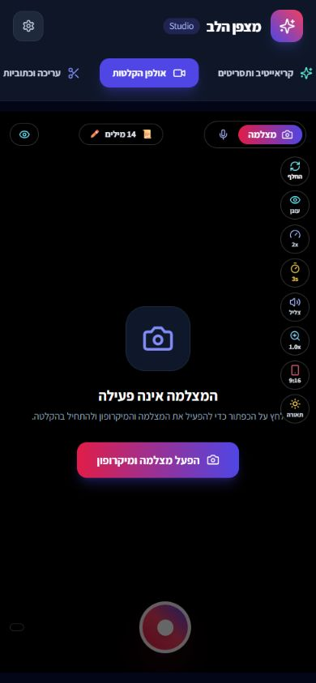
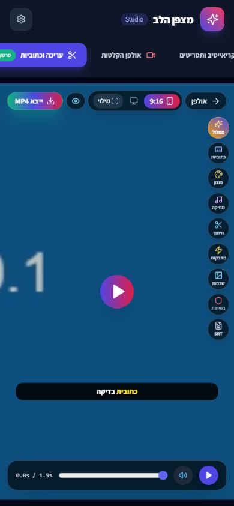
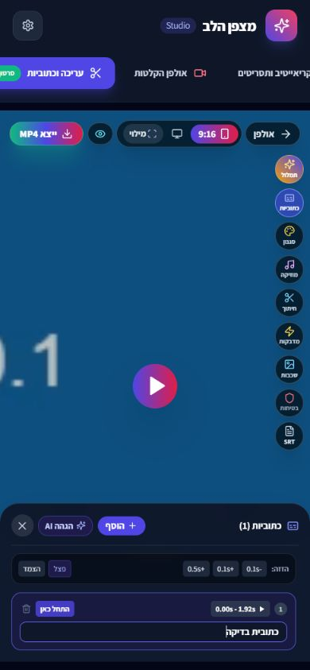
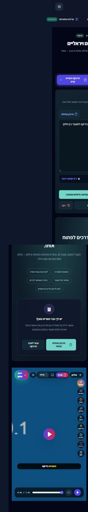
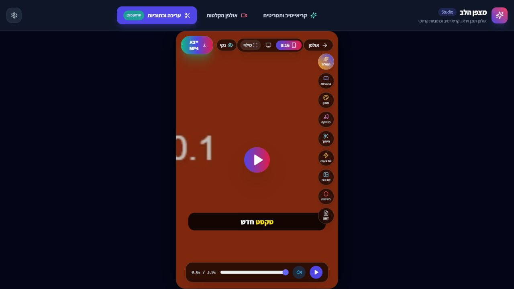

# דוח QA ומוצר — מצפן הלב Studio

תאריך: 3 בנובמבר 2026
מקור: מאגר `heartcompass3/studio`
זהו דוח הממצאים המקורי, לפני התיקונים. לסטטוס העדכני ראו [תיקונים ואימות](../QA-STATUS.md).

## מסקנה

זרימת ייבוא → כתובית ידנית → ייצוא MP4 פועלת במקרה הקצר שנבדק, אך קיימים כשלים משמעותיים בשימור עבודה, במעבר בין מקורות וידאו, בחלוניות העריכה ובגודל הבמה. מסלול האודיו בתצוגה המקדימה שונה מהייצוא ומכיל הגברה שעלולה לעוות קול חזק. מומלץ לתקן את אלה לפני שימוש בהקלטות חשובות.

נרשמו 15 ממצאים: 7 בעדיפות P1 ו־8 בעדיפות P2. חומרה מבטאת השפעה מוצרית; היא אינה טענה שכל ממצא שוחזר על מכשיר פיזי.

- **שוחזר**: התנהגות שנצפתה בממשק או נמדדה בדפדפן.
- **מוכח בקוד**: מסלול פגום שנמצא בקריאת הקוד, ללא הרצת כל התרחיש בחומרה אמיתית.
- **דיווח משתמש / חשד סיבתי**: התופעה דווחה על ידך; הקשר לסיבה מסוימת עדיין דורש בדיקת מקור מול תוצר.

## מה בוצע בפועל

| תחום | בדיקה ותוצאה |
|---|---|
| בדיקות קיימות | `npm test`: כל 5 הבדיקות עברו. הן מכסות תזמון כתוביות ו־seek, ולא את כל הסטודיו. |
| טיפוסים | `tsc --noEmit` עבר. |
| בניית הפצה | `npm run build` עבר בעותק הבדיקה; 1,595 מודולים עובדו. |
| דסקטופ | בדיקות דפדפן ב־1280×720: ניווט, הזנת תסריט, מעבר לאולפן, ייבוא וידאו וחלונית כתוביות. |
| מובייל | הדמיית viewport בגודל 390×844 באותו מנוע דפדפן: ניווט, עריכת תסריט, ייבוא, כתוביות, ייצוא, טעינה חוזרת ורענון. |
| מדיה | נוצרו סרטוני בדיקה סינתטיים של כ־2 וכ־4 שניות עם אות שמע סינתטי; לא נעשה שימוש בהקלטות האישיות שלך. |
| ייצוא | נוצר MP4, נטען שוב בעורך ונמדדו 1080×1920, משך 1.92 שניות ו־readyState 4. הכתובית הופיעה צרובה בתמונה. |
| שגיאות דפדפן | לא נמצאו הודעות error/warn בזמן בדיקת הייצוא הקצרה. זו אינה בדיקת איכות שמע. |

**מגבלות:** לא נבדקו מצלמה ומיקרופון פיזיים, Safari/iPhone, Android פיזי, שיתוף לאפליקציות, הקלטות ארוכות או תשובות Gemini חיות. אין בדוח אישור לצלילות השמע. לא בוצעה האזנה השוואתית להקלטת המקור שלך ולייצוא הבעייתי. ניסיון להרחיב את בדיקת המובייל ללשונית נוספת נדחה בשער הרשאות הדפדפן; לא נעשה ניסיון לעקוף זאת. לפיכך רק גדלי המסך שאומתו בטבלה נחשבים כיסוי בפועל.

## ממצאים בעדיפות גבוהה — P1

### 01. סרטון מיובא גובר על הקלטה חדשה

**מוכח בקוד · מחשב ומובייל.**

בעורך, `activeVideoUrl = uploadedUrl || videoUrl` וגם `activeVideoBlob = uploadedBlob || videoBlob`. לאחר ייבוא, הכתובת וה־Blob המקומיים נשארים בעלי קדימות גם כאשר האולפן מעביר הקלטה חדשה ל־App. העורך נשאר מותקן במעבר בין הלשוניות.

**שחזור מיועד:** ייבא סרטון A → עבור לאולפן → הקלט B → עבור לעריכה.
**התקלה:** הנתונים החדשים מהאולפן אינם יכולים לגבור על A.
**השפעה:** עריכה או ייצוא של הסרטון הלא נכון.
**תיקון:** מקור וידאו פעיל יחיד בבעלות הפרויקט; לאפס את מקור הייבוא המקומי בכל קבלת מדיה חדשה.

מיקום: `src/components/Editor/VideoEditor.tsx:44–48`, `src/App.tsx:98–115`.

### 02. רענון מאבד את המדיה, העריכה והתסריט המודבק

**שוחזר · מחשב ומובייל.**

**שחזור:** הדבק תסריט, ייבא סרטון, הוסף כתובית ורענן את העמוד.
**תוצאה שנצפתה:** מסך הקריאייטיב חזר למצב הפתיחה, תג הסרטון נעלם והעורך הציג שאין וידאו. התסריט המודבק והכתובית לא שוחזרו. לא הופיעה אזהרת עבודה לא שמורה.

`App` והעורך מחזיקים את המידע בזיכרון React. השמירה ב־CreativeV2 מופעלת רק כשקיים `pack` ואינה כוללת את `pastedScript`. פונקציות שמירת הפרויקט ב־`src/v2/project.ts` אינן מחוברות לעורך הפעיל.

**תיקון:** שמירה אוטומטית של פרויקט כולל מדיה ב־IndexedDB, שחזור בטעינה, סטטוס שמירה והתרעה כשאי אפשר לשמור. אין צורך לשמור Blob ב־localStorage.

מיקום: `src/App.tsx:17–21`, `src/components/CreativeV2.tsx:149–160`, מצבי העורך ב־`VideoEditor.tsx`.

### 03. לחיצה בתוך חלונית העריכה סוגרת אותה

**שוחזר בדסקטופ ובתצוגת מובייל.**

**שחזור:** ייבא סרטון → כתוביות → הוסף.
**תוצאה:** הכתובית מתווספת, אך החלונית נסגרת מיד. צריך לפתוח אותה מחדש כדי לערוך את הטקסט. התקלה שוחזרה גם ב־1280×720 וגם ב־390×844.

אירוע הלחיצה עולה אל `editor-stage`, שסוגר כל חלונית פתוחה. למעטפת חלונית העריכה אין עצירת bubbling. אותו מבנה קיים גם באולפן, ולכן פעולות בחלוניות האולפן דורשות בדיקה דומה.

**תיקון:** לסגור חלוניות רק בלחיצה על הרקע החיצוני, ולעצור מעבר של אירועי אינטראקציה מתוך החלונית.

מיקום: `src/components/Editor/VideoEditor.tsx:831–836,1242–1244`; מקבילה ב־`RecordingStudio.tsx:926` בקירוב.

### 04. מעבר מהאולפן מוחק את ספריית הטייקים

**מוכח בקוד · מחשב ומובייל.**

האולפן מותקן רק כאשר `activeTab === 'studio'`. רשימת `takes`, סימוני מועדפים, הטייק הנבחר ורוב הגדרות האולפן הם state מקומי. היציאה לעריכה מסירה את הרכיב; החזרה יוצרת רשימה ריקה. App שומר רק Blob נבחר אחד, לא את הספרייה.

**שחזור מיועד:** הקלט כמה טייקים וסמן מועדף → עבור לעריכה → חזור לאולפן.
**תיקון:** להעביר את הטייקים והגדרות ההפקה למצב פרויקט מתמשך ולשמור אותם. יש לטפל במפורש גם ביציאה בזמן הקלטה.

מיקום: `src/App.tsx:87`, `src/components/Studio/RecordingStudio.tsx:99–100,173–181`.

### 13. ההפעלה המקומית אינה מספקת גישה מטלפון נפרד

**מוכח בהגדרות · מובייל פיזי.**

`vite.config.ts` מקשיב ל־`127.0.0.1`. לכן ההפעלה הרגילה מיועדת למחשב המקומי ואינה נקודת כניסה מטלפון אחר. בדיקת רוחב מובייל בדפדפן במחשב אינה מוכיחה שניתן להשתמש במוצר מהטלפון.

**תיקון:** להגדיר מסלול שימוש מוגדר לטלפון, רצוי כתובת HTTPS נגישה, ולבדוק בו גישה למצלמה, למיקרופון, הורדה ושיתוף. שינוי רוחב CSS לבדו אינו משלים את הזרימה הזאת.

מיקום: `vite.config.ts:8`. גם התיעוד מציין פורט 3000 בעוד שהקונפיגורציה משתמשת ב־3001; זוהי אי־התאמה נוספת בהוראות ההפעלה.

### 14. חישוב הבמה יכול לשבור את יחס התמונה לאחר הפחתת גובה הכותרת

**פגם מדוד בדסקטופ; בעיית מובייל דווחה על ידך.**

האולפן והעורך משתמשים באותה נוסחה: רוחב לפי `100dvh × 9/16`, וגובה לפי מינימום בין `100%` ל־`100vw × 16/9`. שני הממדים נקבעים בנפרד. האזור הזמין קטן מגובה החלון בגלל הניווט, ובמובייל הניווט עובר לשתי שורות. כאשר מגבלת הגובה מופעלת, הרוחב אינו מחושב מחדש לפי הגובה המצומצם.

**מדידה:** בעורך בדסקטופ 1280×720, הבמה הייתה 405×643.2. היחס הוא 0.6297, בעוד ש־9:16 הוא 0.5625. במה ברוחב 405 צריכה גובה 720 כדי לשמור על היחס; השטח הפנוי אינו מאפשר זאת. יש להקטין גם את הרוחב.

במובייל הגבוה שנמדד, 390×844, התקבלו כ־390.4×694.0 והיחס היה קרוב ל־9:16. לכן אין טענה שכל גודל מובייל מעוות: דיווחך מחייב השלמת בדיקה בגובה ובמכשיר שבהם נתקלת בתקלה. בנוסף נמדדה חריגה קלה ברוחב והניווט נחתך, כמפורט בממצא 07.

**השפעה:** במה ומיקום בקרות שאינם עקביים עם שטח העבודה, וחיתוך שונה של המדיה ביחס למה שהמשתמש מצפה לראות.

**תיקון:** למדוד את מכולת העבודה הזמינה לאחר הכותרת, לחשב `scale = min(availableWidth / targetWidth, availableHeight / targetHeight)` ולהפיק את שני הממדים מאותו scale. להשתמש באותה פונקציית פריסה באולפן ובעורך, ולבדוק גבהים קצרים, מצב אופקי וסרגלי דפדפן ניידים.

מיקום: `src/components/Studio/RecordingStudio.tsx:906–923`, `src/components/Editor/VideoEditor.tsx:807–825`.

### 15. הגברת ייצוא ללא הגבלת שיאים — חשד מרכזי לעיוות, עדיין לא אבחנה של התקתוקים

**הקול הלא צלול והתקתוקים דווחו על ידך. מנגנון סיכון מוכח בקוד; התופעה לא שוחזרה בהאזנה בבדיקה זו.**

במסלול WebCodecs הייצוא מכפיל את קול המקור ב־`sourceVolume × 1.5`, ומחבר אותו ישירות ליעד ה־OfflineAudioContext. מוזיקה מצטרפת לאותו יעד. אין שם limiter או בדיקת peak משותפת לפני קידוד AAC. גם ב־fallback יש הגברה דומה.

בעוצמת מקור 100%, שיא מקור מעל כ־0.667 יגיע מעל 1.0 במיקס לפני הקידוד. למשל 0.8×1.5=1.2. זהו סיכון ממשי לחריגת שיא ולעיוות, במיוחד עם מוזיקה. בהקלטה עצמה קיימת גם הגברה נוספת, ובתצוגה המקדימה נעשה שימוש בקומפרסור שאינו זהה למסלול הייצוא.

בקול המקור אין מעטפת fade קצרה בגבולות החיתוך. חיתוך בנקודת גל שאינה אפס הוא הסבר אפשרי לקליק בתחילת/סוף קטע. אין די ראיות לייחס לכך תקתוקים חוזרים לאורך הקובץ; יש לבדוק גם את נתיב ה־fallback, את המקור ואת גבולות המוזיקה.

**תיקון מוצע:** להשוות את המקור והתוצר; להסיר הגברה נסתרת כברירת מחדל; ליצור גרף עיבוד משותף לתצוגה ולייצוא; להוסיף headroom ו־limiter אחרי סכימת הערוצים; להחליק שינויי gain ולהוסיף fades קצרים בגבולות החיתוך. אין להסתפק בהחלפת קודק או בהגדלת bitrate.

**קריטריון קבלה:** בדיקה עם דיבור חלש וחזק, חיתוך באמצע גל, מוזיקה ובלעדיה; peak/RMS, בדיקת חריגות/קפיצות במשרעת והאזנה למקור מול תוצר. לבדוק בנפרד WebCodecs ו־MediaRecorder. תקתוקים חוזרים דורשים דוגמת מקור ותוצר מאותו קטע כדי לקבוע סיבה.

מיקום: `src/components/Studio/RecordingStudio.tsx:499`; `src/components/Editor/VideoEditor.tsx:124–151`; `src/services/mp4ExportService.ts:661–693,1068`.

## ממצאים בעדיפות בינונית — P2

### 05. תסריט שעודכן באולפן אינו מסתנכרן חזרה לקריאייטיב

**שוחזר.** הודבק תסריט של 10 מילים, נוספו מילים מתוך האולפן והמונה שם עלה ל־14. בחזרה לתיבת ההדבקה בקריאייטיב נותרו הטקסט הישן ומונה 10. שליחה חוזרת משם עלולה לדרוס את הגרסה החדשה.

ה־effect מעדכן `pastedScript` רק כשהוא ריק. יש לאחד את מקור האמת של התסריט או להגדיר ניהול מפורש של טיוטות.

מיקום: `src/components/CreativeV2.tsx:54–58`.

### 06. ״לעיצוב הקאבר״ אינו מעביר את הקאבר לעורך

**שוחזר בממשק ואומת בקוד.** כפתור הדוגמה העביר לעורך ריק כאשר לא הייתה מדיה. לאחר טעינת מדיה, שדה הכותרת בעיצוב נשאר ריק. `App` מעדכן `coverTitle`, אך אינו מעביר אותו ל־VideoEditor; שדה `headlineText` מתחיל במחרוזת ריקה ואין לעורך prop של קאבר.

**תיקון:** להעביר את הכותרת למצב הפרויקט ולשדה או לשכבת קאבר מוגדרת. אם אין וידאו, לשמור את הכוונה ולהציג צעד המשך שמאפשר לטעון וידאו בלי לאבד אותה.

מיקום: `src/App.tsx:12,79–82,99–114`, `src/components/Editor/VideoEditor.tsx:80`.

### 07. הניווט העליון נחתך במובייל

**שוחזר ב־390×844.** שלוש לשוניות בעלות `whitespace-nowrap`, ריווח ורוחב מצטבר שאינו נכנס למסך. במדידה אחת לשונית העריכה התחילה ב־x=-20 ולשונית הקריאייטיב הסתיימה ב־x=395, מעבר לרוחב 390. כאשר מופיע תג ״סרטון מוכן״ הבעיה מחמירה.

**תיקון:** שלוש עמודות גמישות, תוויות מקוצרות או ניווט תחתון; לתג יש להקצות מקום בלי להגדיל את רוחב הלשונית. לבדוק לאחר הוספת וידאו, לא רק במסך הריק.

מיקום: `src/components/Navigation.tsx:73–113`. תיעוד: `mobile-studio.png`, `mobile-editor.png`.

### 08. העורך אינו מוסתר בפועל במעבר לקריאייטיב

**שוחזר ונמדד.** למעטפת יש `hidden`, אך גם מחלקת `flex` שגוברת על ההסתרה. אחרי ייבוא וחזרה לקריאייטיב נמדדה מעטפת עם `hidden=true`, `display:flex` וגובה 610.1 פיקסלים. בקרי העורך נשארו בעץ הנגישות ובמסמך שמתחת לקריאייטיב.

**תיקון:** להחיל `display:none` מפורש במצב לא פעיל, בלי לאבד את state העריכה; לא להסתמך על hidden יחד עם display:flex סותר.

מיקום: `src/App.tsx:98`. תיעוד: `mobile-editor-leak.png`.

### 09. בקרי בס והדהוד אינם מחוברים לעיבוד ההקלטה

**מוכח בקוד.** הסליידרים משנים `voiceEffects.bassDb` ו־`reverbMix`, אך מסלול ההקלטה יוצר רק gain וקומפרסור. `updateVoiceEffects` משנה אילוצי סינון של המיקרופון בלבד. פונקציית `createVoiceAudioGraph` קיימת בקובץ שירות אך אינה משמשת באולפן הפעיל.

**תיקון:** לחבר את הגרף בפועל ולהחיל שינויי פרמטרים בהדרגה; לבדוק שהתוצאה נשמעת גם בקובץ המוקלט, לא רק בסליידר.

מיקום: `src/components/Studio/RecordingStudio.tsx:60–73,487–513,1433–1457`, `src/services/meditationAudio.ts`.

### 10. תאורה וזום דיגיטלי אינם משתקפים בעקביות בקובץ המוקלט

**מוכח בקוד.** תצוגת המצלמה משנה brightness ו־transform ב־CSS. מסלול ההקלטה הישיר משתמש ב־MediaStream המקורי. גם מסלול חיתוך ה־canvas אינו מחיל brightness או את zoomLevel הדיגיטלי. לכן מה שמוצג אינו בהכרח מה שנשמר. זום חומרה, אם הוחל על המסלול במכשיר, הוא מקרה אחר ודורש בדיקה פיזית.

**תיקון:** להגדיר אילו אפקטים מיועדים לתצוגה בלבד ואילו לצריבה, וליישם את האחרונים באותו compositor גם בתצוגה וגם בהקלטה.

מיקום: `src/components/Studio/RecordingStudio.tsx:522–565,954–963`.

### 11. החלפת וידאו אינה מאפסת את כל נתוני העריכה התלויים בו

**מוכח בקוד.** בייבוא מאופסים captions וחיתוך, אך מוזיקה, כותרת, שכבות ומדבקות נשארות. בקבלת הקלטה חדשה דרך props אין effect שמאפס כתוביות וחיתוך לפי זהות המדיה. מעבר מקטע ארוך לקצר עלול להשאיר זמנים שאינם מתאימים לקובץ החדש.

**תיקון:** לזהות החלפת asset ולבקש בחירה מפורשת אם לשמר עיצוב; לאפס או למפות מחדש פריטים מתוזמנים. אין לשייך כתוביות ישנות אוטומטית להקלטה אחרת.

מיקום: `src/components/Editor/VideoEditor.tsx:263–279,302–309`.

### 12. המיקס בתצוגה המקדימה שונה מהמיקס המיוצא

**מוכח בקוד.** התצוגה משתמשת בהגברה של 1.8 וקומפרסור; הייצוא הראשי משתמש ב־1.5 וללא אותו קומפרסור. חלק מפקדי הניגון גם משנים `video.volume` בחזרה ל־1.0. לכן כיוון עוצמות בתצוגה אינו מבטיח אותה תוצאה בקובץ.

**תיקון:** גרף עיבוד ופרמטרים משותפים, רמות gain עקביות ובדיקת השוואה כמותית. ממצא זה קשור לממצא 15, אך עוסק בנאמנות התצוגה לתוצר גם כשהשמע אינו מגיע לעיוות.

מיקום: `src/components/Editor/VideoEditor.tsx:124–173,417–432`, `src/services/mp4ExportService.ts:661,1068`.

## סדר תיקון מוצע

1. **גודל במה וצלילות שמע:** לתקן חישוב ממדים משותף ולחקור את הקול מול מקור/תוצר. אלה התקלות שהוספת במהלך הסריקה.
2. **שלמות העבודה:** מקור מדיה יחיד, שמירת טייקים ופרויקט, שחזור אחרי רענון.
3. **פעולת העורך:** תיקון bubbling, הסתרה אמיתית של מסכים וניווט מובייל שאינו נחתך.
4. **העברות בין חלקים:** סנכרון תסריט, העברת קאבר ואיפוס עריכה בעת החלפת מדיה.
5. **השלמת קבלה פיזית:** iPhone ו־Android, לרוחב ולאורך, עם סרגלי דפדפן פתוחים, הקלטה ארוכה, פסקול ושיתוף/שמירה למכשיר.

## בדיקות קבלה נדרשות לאחר התיקון

- במה ביחס 9:16 או 16:9 בתוך השטח הפנוי, עם בקרות נגישות במובייל קצר וגבוה ובמצב אופקי.
- ייבוא A → הקלטה B → העורך מציג ומייצא B.
- כמה טייקים → עריכה → חזרה לאולפן → כל הטייקים והמועדפים נשמרו.
- רענון → הפרויקט, המדיה, התסריט והעריכה משוחזרים.
- פתיחת חלונית → לחיצה/הקלדה/גרירת סליידר → החלונית נשארת פתוחה.
- שינוי תסריט באולפן → חזרה לקריאייטיב → אותה גרסה.
- בחירת קאבר → טעינת וידאו → הטקסט מופיע במיקום הייעודי ומיוצא.
- מקור/תוצר של דיבור אמיתי: ללא חריגת שיאים, ללא שינוי עוצמה בלתי צפוי, ללא קליקים בגבולות וללא תקתוקים חוזרים.
- קובץ ארוך עם מוזיקה: תמונה ושמע מסונכרנים בתחילה, באמצע ובסוף; לבדוק גם את נתיב הייצוא החלופי.

## תיעוד חזותי

